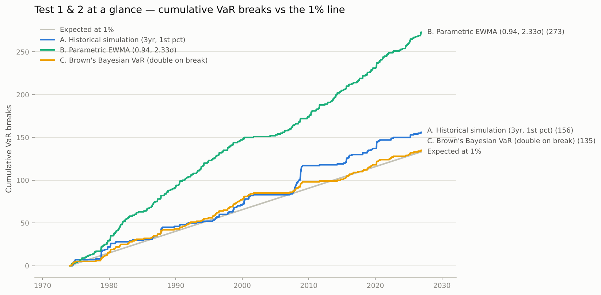

# VAR — Value at Risk backtesting on the NASDAQ Composite

**Live page: <https://zenoonan.github.io/Research/VAR/>** — the scorecard,
the charts and every p-value, built to be read on a phone.

An implementation of the VaR framework in Aaron Brown's *"Forced by the
Sternest Circumstances"* (Wilmott magazine, July 2009), run on the NASDAQ
Composite index (FRED series `NASDAQCOM`, 1971–2026) for a hypothetical
**$1,000,000** portfolio.

The point of the article — and of this project — is not the VaR number
itself but the **checks**. A daily 99% VaR is only a VaR if nobody could
make money betting for or against your break days at 99-to-1 odds. Brown
gives three tests every VaR methodology must pass:

> 1. The actual fraction of VaR break days is 1 percent, within statistical
>    tolerance;
> 2. The VaR breaks are randomly distributed in time;
> 3. The VaR breaks are independent of the level of VaR.

A *break* is a day the portfolio loses more than its VaR.

## The three methods

All three use the article's parameters unchanged — nothing is fitted to this
dataset:

| | Method | Rule |
|---|---|---|
| A | Historical simulation | The 1% loss point of the last 3 years (750 trading days) of returns — the "distribution-free" textbook method. Placed by the article's rule (see [the percentile](#the-percentile-and-a-correction)) |
| B | Parametric (RiskMetrics) | EWMA variance: 0.94 × yesterday's variance + 0.06 × today's move²; VaR = 2.33σ |
| C | Brown's "Bayesian" VaR | Start from 2.33 × 3-year standard deviation. After a break, **double** the estimate; otherwise take 0.94 × yesterday's estimate + 0.06 × the simple estimate |

## Results (1974-01-29 to 2026-11-17, 13,314 predictions, 133 breaks expected)

| Method | Breaks | Test 1: frequency | Test 2: random in time | Test 3: independent of level |
|---|---|---|---|---|
| A. Historical simulation (3yr, 1st pct) | 156 | PASS (borderline, p = 0.053) | FAIL | FAIL |
| B. Parametric EWMA (0.94, 2.33σ) | 273 | FAIL | FAIL | FAIL |
| C. Brown's Bayesian VaR (double on break) | 135 | **PASS** | **PASS** (borderline, p = 0.064) | FAIL (borderline, p = 0.018) |

A test passes at p ≥ 0.05. *Borderline* marks a p-value between 0.01 and
0.10, where a 1% or a 10% tolerance would have given the other answer.

**Historical simulation** gets the number of breaks roughly right — 156
against 133, inside tolerance but only just. It fails on *when* they come:
15 breaks landed the day after another break where independence predicts
about 2, and 66 within ten days of one where it predicts 17. Volatility
clusters, and a three-year window cannot see it.

**Parametric EWMA** reacts within days but breaks twice as often as it
should, and its breaks still cluster. Both textbook methods also break
disproportionately when they say things are safe: VaR on break days averages
9% (A) and 19% (B) below the overall average.

**Brown's double-on-break rule**, with no tuning at all, has 135 breaks
against 133 expected, and most of the clustering is gone (4 next-day breaks
against 1.4 expected). It passes Test 2, narrowly. It does not pass Test 3
on this series: its VaR on break days averages 10% below its overall
average, where the article's S&P 500 run erred slightly the other way. It is
the only one of the three that no test rejects decisively — but a
non-rubber-stamp backtest reports two passes and a narrow fail, not three
passes.

The pattern is the article's, less dramatically than on its S&P 500 data
(where historical simulation had 314 breaks against 199 and Brown's rule
passed all three). Recalibrating the textbook methods to give exactly the
expected break count — the article's "two out of three?" exercise: the 0.82
percentile, or 2.95σ — fixes Test 1 by construction and leaves Tests 2 and 3
failing. The break count is not the problem; the clustering is.

The months added in November 2026 (3 July to 17 November, about one break
expected) included a fall of nearly 12% from the 6 October peak, with a 5.5%
drop on 5 November. Historical simulation and Brown's rule each broke once,
on 5 November. EWMA broke four times in three weeks, from 16 October to
5 November: its breaks cluster again. No verdict changed. The page's *2026*
button shows the year.

Full numbers and p-values: the [live page](https://zenoonan.github.io/Research/VAR/)
or **[results/backtest_report.md](results/backtest_report.md)**.



## The percentile, and a correction

The article builds historical simulation so that a break has a 1% chance
whenever returns are independent draws from one distribution: a new day is
equally likely to rank anywhere among the window's *n* days and itself, so
"worse than the fifth worst of the last 499 days" has probability 5/500. The
1% point therefore sits at rank *p × (n + 1)* from the worst day — rank 7.51
of 750, between the 7th and 8th worst.

The first version of this project (July 2026) took the 1st percentile from
numpy instead. That is the spreadsheet convention, rank *p × (n − 1) + 1* =
8.49: nearly one whole day less extreme. On simulated returns with nothing to
cluster it breaks on **1.12%** of days, not 1%; the article's rule breaks on
**0.99%**. On the NASDAQ data through 2 July 2026 the bias was about half of
historical simulation's excess breaks: it reported 176 and a decisive Test 1
failure (p = 0.0003) where the method as the article specifies it has 155 and
a borderline pass.
Tests 2 and 3, and methods B and C, were unaffected.

## How the checks are computed

- **Test 1** — Kupiec proportion-of-failures likelihood-ratio test against a
  1% break probability, plus the plain z-score.
- **Test 2** — the article's own diagnostics (breaks landing the day after a
  break, and within ten days of a break, versus their expectations under
  independence at the method's own break rate) with binomial p-values, plus
  the Christoffersen independence test on the break sequence. It passes when
  the Christoffersen and ten-day p-values both clear the tolerance.
- **Test 3** — average VaR on break days versus overall average VaR. If
  breaks are independent of the level, break days are a uniformly random
  sample of days, so a permutation test on the break-day average (100,000
  draws) is exact under the null; a Welch t-test is shown alongside.

## Running it

```bash
pip install -r requirements.txt
python3 build_site.py               # backtests -> report, charts and index.html
python3 test_pipeline.py            # must end "All checks passed"
python3 test_pipeline.py --self-test
```

`build_site.py` is the one command: it runs the backtests, rewrites
`results/`, and writes `index.html` from `template.html`. The build is
deterministic, so building twice gives the same bytes. (`python3
var_backtest.py` alone rewrites only the report and charts.)

`test_pipeline.py` is the check that the page is right. It recomputes every
figure in the page's data block from `data/NASDAQCOM.csv` — each day's loss,
all three VaR series, every break day, count, p-value and verdict, the
figures quoted in the commentary — and it **never imports the pipeline**: it
uses only the standard library, with its own rolling window and its own
chi-square, binomial, Student-t and permutation tests. It also simulates
ideal data to confirm the percentile rule above. `--self-test` plants 25
faults in a copy of the page (the spreadsheet percentile, a VaR that has
seen the day it is judged against, swapped p-values, a flipped verdict, a
day-first date in the file) and confirms each one is caught. Keep it
independent: a check that shares the pipeline's code shares its mistakes.

## Files

```
VAR/
├── README.md               # this file
├── var_backtest.py         # the three methods, the three backtests, report and charts
├── build_site.py           # runs everything and writes index.html
├── template.html           # the page: layout, styles and chart code
├── index.html              # the built page (GitHub Pages serves this)
├── test_pipeline.py        # independent check of every published figure
├── requirements.txt
├── data/NASDAQCOM.csv      # FRED NASDAQ Composite, daily closes
└── results/                # generated: backtest_report.md + three PNG charts
```

## Data notes

- Source: FRED `NASDAQCOM` (NASDAQ Composite index, daily close),
  1971-02-05 to 2026-11-17: 14,552 rows, of which 487 are blank.
- Blank observations (market holidays) are dropped, per FRED convention —
  the return across a holiday is treated as an ordinary one-day return.
  FRED's file has no row at all for Labor Day 2026 (7 September), where every
  other holiday is a blank row. It comes to the same thing, and
  `test_pipeline.py` treats a weekday with no row as a blank and lists any it
  finds.
- Returns are simple daily percentage changes; dollar loss is
  −$1M × return.
- The first 750 trading days seed the 3-year windows, so VaR predictions
  start in January 1974.
- To extend the data, download the series again from FRED over
  `data/NASDAQCOM.csv` and rebuild. If a verdict moves across a line, the
  build stops and says which sentence of the commentary to revisit.
