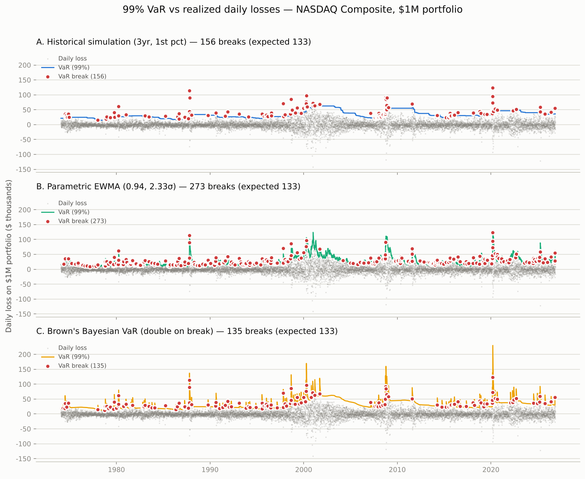
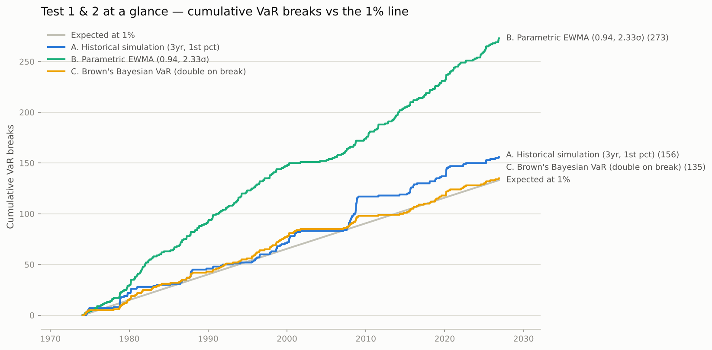
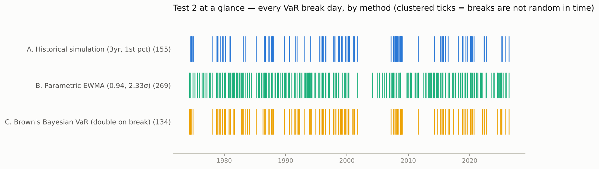

# VaR backtest report — NASDAQ Composite

Three daily 99% VaR estimators for a **$1,000,000** position in the
NASDAQ Composite (FRED `NASDAQCOM`), scored against the three tests in
Aaron Brown's *"Forced by the Sternest Circumstances"* (Wilmott, 2009):

> 1. The actual fraction of VaR break days is 1 percent, within statistical tolerance;
> 2. The VaR breaks are randomly distributed in time;
> 3. The VaR breaks are independent of the level of VaR.

Backtest window: **1974-01-29 to 2026-11-17** (13,314 daily VaR predictions after a 750-day warm-up).
A *break* is a day the portfolio loses more than its VaR.

A test passes when its p-value is at least 0.05. A verdict is marked
*borderline* when that p-value lies between 0.01 and 0.1: a 1% or a
10% tolerance would have given the other answer.

## Scorecard

| Method | Breaks (obs/exp) | Test 1: frequency | Test 2: random in time | Test 3: independent of level |
|---|---|---|---|---|
| A. Historical simulation (3yr, 1st pct) | 156 / 133 exp. | PASS (borderline) | FAIL | FAIL |
| B. Parametric EWMA (0.94, 2.33σ) | 273 / 133 exp. | FAIL | FAIL | FAIL |
| C. Brown's Bayesian VaR (double on break) | 135 / 133 exp. | PASS | PASS (borderline) | FAIL (borderline) |

### Reading the results

Historical simulation, built the way the article specifies, gets the number of breaks roughly right: 156 against 133 expected, inside tolerance but only just (p = 0.053). It fails on when they come. 15 breaks landed the day after another break, where independence predicts about 2; 66 came within ten days of one, where it predicts 17. Volatility clusters, and a three-year window cannot see it.

Parametric EWMA reacts within days but breaks 2.1 times as often as it should (273 breaks), and its breaks still cluster. Both textbook methods also break disproportionately on days when they say things are safe: VaR on break days averages 9% below the overall average for historical simulation and 19% below for EWMA.

Brown's double-on-break rule — the article's parameters untouched, nothing fitted to this data — has 135 breaks against 133 expected, and most of the clustering is gone: 4 next-day breaks against 1.4 expected, and 17 within ten days against 13. That passes Test 2, narrowly (p = 0.064). It does not pass Test 3 on this series: its VaR on break days averages 10% below its overall average (p = 0.018), where the article's S&P 500 run erred slightly the other way. It is the only one of the three that no test rejects decisively — but a nonrubber-stamp backtest reports two passes and a narrow fail, not three passes.

## Method detail

### A. Historical simulation (3yr, 1st pct)

The 1% loss point of the last 750 daily returns — the "distribution-free" method in every textbook. It sits between the 7th and 8th worst days of the window, where a break has a 1% chance if returns are independent draws from one distribution.

**Test 1 — break frequency is 1%: PASS (borderline)**

| Metric | Value |
|---|---|
| Observations | 13,314 |
| VaR breaks | 156 |
| Expected breaks (1%) | 133 |
| Observed break rate | 1.17% |
| z-score vs 1% | +2.0 |
| Kupiec POF p-value | 0.053 |

**Test 2 — breaks randomly distributed in time: FAIL**

| Metric | Observed | Expected if independent | p-value |
|---|---|---|---|
| Breaks the day after a break | 15 | 1.8 | 6.3e-10 |
| Breaks within 10 days of a break | 66 | 17.2 | 1.9e-23 |
| Christoffersen independence test | — | — | 4e-10 |

**Test 3 — breaks independent of the VaR level: FAIL**

| Metric | Value |
|---|---|
| Average VaR | $32,973 |
| Average VaR on break days | $29,943 |
| Ratio (break days / all days) | 0.91 |
| Permutation test p-value (are break days a random sample of days?) | 0.001 |
| Welch t-test p-value (break vs non-break days) | 0.00076 |

**Result:** Test 1 PASS (borderline) · Test 2 FAIL · Test 3 FAIL

### B. Parametric EWMA (0.94, 2.33σ)

RiskMetrics: variance = 0.94 × yesterday's variance + 0.06 × today's move squared; VaR = 2.33 standard deviations.

**Test 1 — break frequency is 1%: FAIL**

| Metric | Value |
|---|---|
| Observations | 13,314 |
| VaR breaks | 273 |
| Expected breaks (1%) | 133 |
| Observed break rate | 2.05% |
| z-score vs 1% | +12.2 |
| Kupiec POF p-value | 1.4e-26 |

**Test 2 — breaks randomly distributed in time: FAIL**

| Metric | Observed | Expected if independent | p-value |
|---|---|---|---|
| Breaks the day after a break | 16 | 5.6 | 0.00019 |
| Breaks within 10 days of a break | 77 | 50.9 | 0.00013 |
| Christoffersen independence test | — | — | 0.00022 |

**Test 3 — breaks independent of the VaR level: FAIL**

| Metric | Value |
|---|---|
| Average VaR | $25,821 |
| Average VaR on break days | $21,011 |
| Ratio (break days / all days) | 0.81 |
| Permutation test p-value (are break days a random sample of days?) | < 0.00002 |
| Welch t-test p-value (break vs non-break days) | 1.3e-11 |

**Result:** Test 1 FAIL · Test 2 FAIL · Test 3 FAIL

### C. Brown's Bayesian VaR (double on break)

Start from 2.33 × the 3-year standard deviation. After a break, double the estimate; otherwise take 0.94 × yesterday's estimate + 0.06 × the simple estimate.

**Test 1 — break frequency is 1%: PASS**

| Metric | Value |
|---|---|
| Observations | 13,314 |
| VaR breaks | 135 |
| Expected breaks (1%) | 133 |
| Observed break rate | 1.01% |
| z-score vs 1% | +0.2 |
| Kupiec POF p-value | 0.87 |

**Test 2 — breaks randomly distributed in time: PASS (borderline)**

| Metric | Observed | Expected if independent | p-value |
|---|---|---|---|
| Breaks the day after a break | 4 | 1.4 | 0.048 |
| Breaks within 10 days of a break | 17 | 13.0 | 0.24 |
| Christoffersen independence test | — | — | 0.064 |

**Test 3 — breaks independent of the VaR level: FAIL (borderline)**

| Metric | Value |
|---|---|
| Average VaR | $32,559 |
| Average VaR on break days | $29,440 |
| Ratio (break days / all days) | 0.90 |
| Permutation test p-value (are break days a random sample of days?) | 0.018 |
| Welch t-test p-value (break vs non-break days) | 0.023 |

**Result:** Test 1 PASS · Test 2 PASS (borderline) · Test 3 FAIL (borderline)

## "Should we try for two out of three?" — recalibrated variants

As in the article, the percentile and the sigma multiplier can be moved until the break count is exactly the expected number. Both recalibrated methods then pass Test 1 by construction and still fail the other two — the break count is not the problem, the clustering is.

| Method | Breaks (obs/exp) | Test 1: frequency | Test 2: random in time | Test 3: independent of level |
|---|---|---|---|---|
| A2. Historical simulation recalibrated (0.82 pct) | 133 / 133 exp. | PASS | FAIL | FAIL |
| B2. Parametric recalibrated (2.95σ) | 133 / 133 exp. | PASS | FAIL | FAIL |

### A2. Historical simulation recalibrated (0.82 pct)

Percentile moved from 1.00 to 0.82 so the break count is the expected 133.

**Test 1 — break frequency is 1%: PASS**

| Metric | Value |
|---|---|
| Observations | 13,314 |
| VaR breaks | 133 |
| Expected breaks (1%) | 133 |
| Observed break rate | 1.00% |
| z-score vs 1% | -0.0 |
| Kupiec POF p-value | 0.99 |

**Test 2 — breaks randomly distributed in time: FAIL**

| Metric | Observed | Expected if independent | p-value |
|---|---|---|---|
| Breaks the day after a break | 14 | 1.3 | 9e-11 |
| Breaks within 10 days of a break | 56 | 12.6 | 3.6e-23 |
| Christoffersen independence test | — | — | 5.1e-11 |

**Test 3 — breaks independent of the VaR level: FAIL**

| Metric | Value |
|---|---|
| Average VaR | $34,822 |
| Average VaR on break days | $31,188 |
| Ratio (break days / all days) | 0.90 |
| Permutation test p-value (are break days a random sample of days?) | 0.00072 |
| Welch t-test p-value (break vs non-break days) | 0.00022 |

**Result:** Test 1 PASS · Test 2 FAIL · Test 3 FAIL

### B2. Parametric recalibrated (2.95σ)

Sigma multiplier moved from 2.33 to 2.95 so the break count is the expected 133.

**Test 1 — break frequency is 1%: PASS**

| Metric | Value |
|---|---|
| Observations | 13,314 |
| VaR breaks | 133 |
| Expected breaks (1%) | 133 |
| Observed break rate | 1.00% |
| z-score vs 1% | -0.0 |
| Kupiec POF p-value | 0.99 |

**Test 2 — breaks randomly distributed in time: FAIL**

| Metric | Observed | Expected if independent | p-value |
|---|---|---|---|
| Breaks the day after a break | 8 | 1.3 | 6.1e-05 |
| Breaks within 10 days of a break | 24 | 12.6 | 0.0026 |
| Christoffersen independence test | — | — | 6.1e-05 |

**Test 3 — breaks independent of the VaR level: FAIL**

| Metric | Value |
|---|---|
| Average VaR | $32,654 |
| Average VaR on break days | $25,726 |
| Ratio (break days / all days) | 0.79 |
| Permutation test p-value (are break days a random sample of days?) | < 0.00002 |
| Welch t-test p-value (break vs non-break days) | 1.2e-07 |

**Result:** Test 1 PASS · Test 2 FAIL · Test 3 FAIL

---
*Generated by `var_backtest.py`. Data: FRED NASDAQCOM (blank observations,*
*i.e. market holidays, dropped as missing). `build_site.py` publishes the*
*same results as a web page, and `test_pipeline.py` recomputes them from the*
*raw data with code of its own.*
